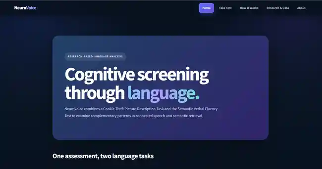
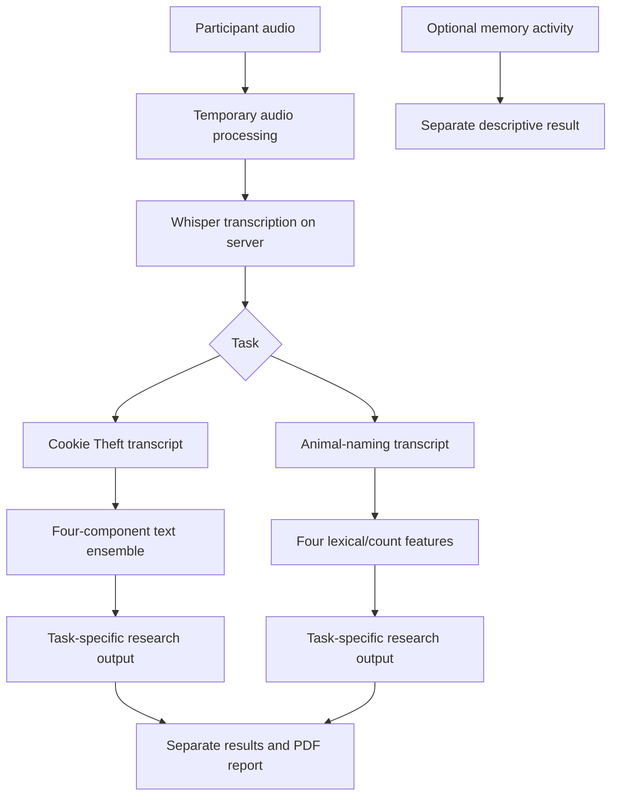
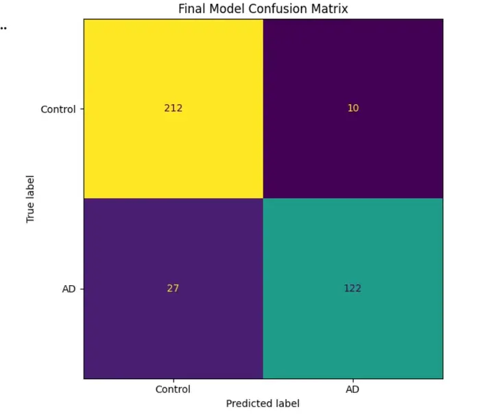
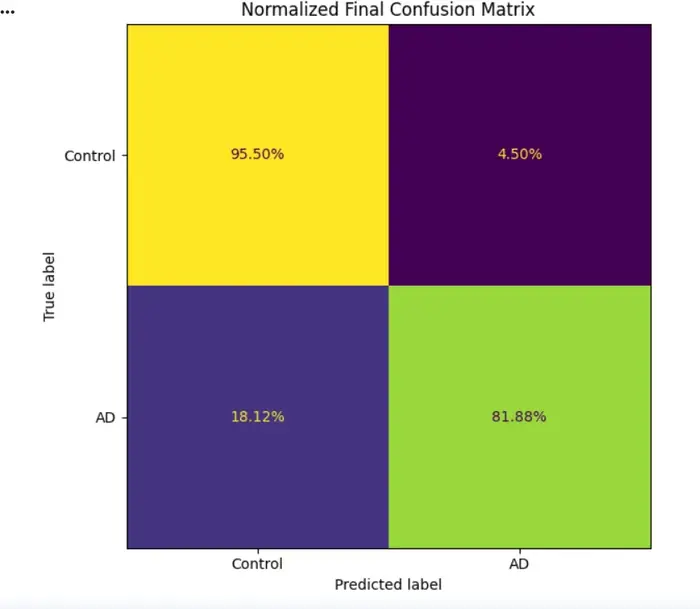
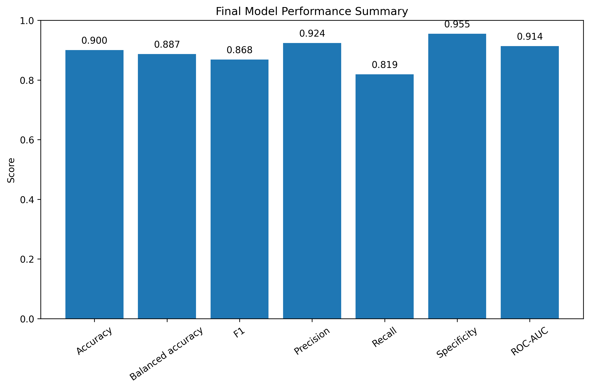
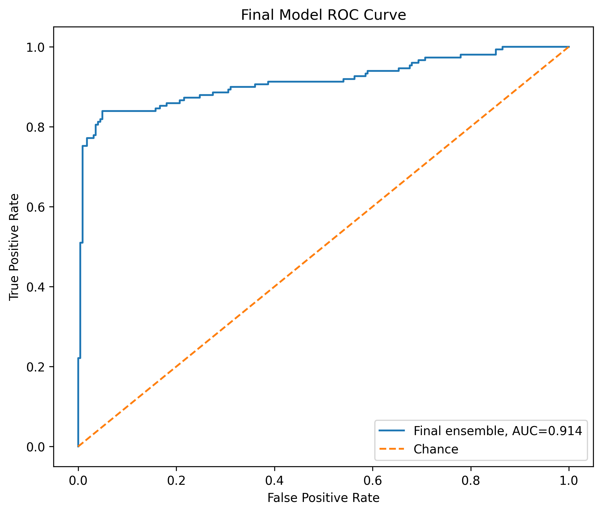
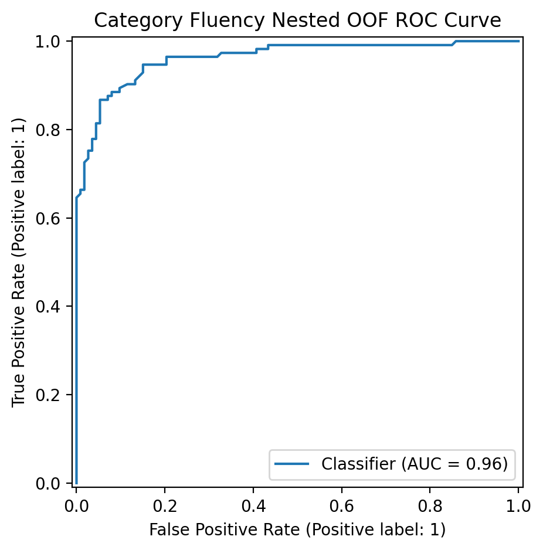

# NeuroVoice

**NeuroVoice** is a student-built research prototype for exploring speech and language patterns in two tasks: the Cookie Theft Picture Description Task and Semantic Verbal Fluency (animal naming).

- **Live application:** https://neurovoice-evfo.onrender.com/
- **Repository:** https://github.com/AstroBeast2000/NeuroVoice

> **Research-use notice:** NeuroVoice is an experimental educational/research prototype. It is not a medical device, diagnostic system, or clinically validated screening tool. Model scores are not probabilities that someone has Alzheimer's disease or another condition. Do not use the application to make health-care decisions.

## Application preview



The screenshot shows the current application landing page.

## What the application does

1. Collects a Cookie Theft picture-description recording.
2. Transcribes the recording with an English Whisper model running on the NeuroVoice server.
3. Passes the transcript through a four-component, transcript-only ensemble.
4. Collects an animal-naming response for the Semantic Verbal Fluency task.
5. Transcribes that recording and derives four response-count/lexical-diversity features.
6. Displays the two task outputs separately and can generate a downloadable research report.

The optional memory activity is a separate descriptive exercise. It is not combined with the speech-model outputs.

## Application architecture



### Current application models

**Cookie Theft Picture Description**

The checked-in application code in `src/cookie_model.py` loads four transcript-based components:

- Word TF-IDF + linear SVM
- Character TF-IDF + linear SVM
- Linguistic-feature logistic regression
- Combined word/character/linguistic logistic regression

The selected ensemble weights are loaded from `models/cookie/validation_selected_configuration.csv` (currently 0.45, 0.15, 0.05, and 0.35), with a saved decision threshold of 0.61. The recording is used for transcription; the current Streamlit inference path does **not** load an acoustic classifier.

**Semantic Verbal Fluency**

The application extracts four features from the transcript:

- Total alphabetic tokens
- Unique tokens
- Repeated tokens
- Type-token ratio (unique tokens divided by total tokens)

The current feature extractor counts alphabetic words; it does not independently verify that each recognized word is a valid animal name. This is a known limitation. The saved model uses a threshold of 0.52.

## Research evaluation artifacts

The repository also contains charts and evaluation files from broader experiments. These artifacts must not be confused with performance of the currently deployed Streamlit inference path.

### Cookie Theft transcript–acoustic fusion experiment

The following confusion matrices show the counts and within-class proportions for this experiment's reported final evaluation. They are descriptive of that evaluation subset and should be interpreted with the post-hoc test-set filtering caveat above.





The file `assets/data/picture/FINAL_evaluation_report.txt` describes a separate transcript–acoustic stacking evaluation. It reports 2,080 training recordings and 371 reviewed test recordings. The report explicitly states that the test subset was filtered after previous model-error inspection; 33 of 404 recordings were removed during quality review. Therefore, these results are **post-hoc diagnostic results**, not an unbiased untouched-test estimate.

The report lists 91.11% accuracy, 89.81% balanced accuracy, 91.41% ROC-AUC, and 92.93% average precision. It also says the acoustic extraction source code was unavailable and the fusion pipeline was reconstructed. The current application code does not load this fusion model. Do not present these figures as the deployed application's validated performance.





### Semantic Verbal Fluency experiment

The repository includes nested cross-validation outputs for 226 participants (113 Pitt Corpus Alzheimer's disease participants and 113 Wisconsin Longitudinal Study controls). The saved metrics report 89.82% accuracy and balanced accuracy, 96.19% ROC-AUC, and 96.72% average precision. The bootstrap interval for ROC-AUC is approximately 93.68%–98.21%.

This evaluation has an important **dataset-source confounding** limitation: diagnosis group and source dataset are linked (Pitt supplies the AD group; WLS supplies the control group). The model may learn study, recruitment, recording, demographic, or transcription differences in addition to cognitive-language patterns. These figures are internal research results, not external validation.



Additional confusion matrices, precision-recall curves, calibration plots, confidence intervals, coefficients, and fold-level results are stored under `assets/charts/` and `assets/data/`.

## Broader data-preparation work

The broader research workflow has involved sources including ADReSS 2020, ADReSSo 2021, ADReSS-M, the Pitt Corpus, the Lu Corpus, and other TalkBank releases. Dataset use varies by experiment; the presence of a dataset in the broader workflow does not mean it trained every model in the web application.

Preprocessing work has included participant-only speech extraction where available, speaker diarization, segmentation, audio normalization, transcription, and metadata alignment. Participant-level separation is important when a participant contributes multiple recordings.

**Data governance:** Raw participant recordings and restricted dataset contents should not be committed to this repository. Follow each dataset's access agreement, citation requirements, and redistribution restrictions. The repository should contain code and permitted derived artifacts only.

## Repository layout

The top-level folders use conventional names based on their role. Timestamped development snapshots have been removed from the active project tree; their earlier versions remain available in Git history.

```text
NeuroVoice/
├── .streamlit/            # Streamlit configuration
├── assets/                # Research figures and permitted derived data
├── docs/                  # Model card and architecture documentation
├── models/                # Trained model artifacts and configuration
├── notebooks/             # Model-training and research notebooks
├── src/                   # Transcription, feature extraction, and inference
├── views/                 # Streamlit application pages
├── .gitignore             # Local files excluded from Git
├── .slugignore            # Files excluded from the Render deployment bundle
├── README.md              # Project overview and setup instructions
├── app.py                 # Streamlit application entry point
├── render.yaml            # Render service configuration
├── render_start.py        # Render startup command
└── requirements.txt       # Python dependencies
```

## Run locally

1. Use Python 3.10 or 3.11.
2. Install FFmpeg and ensure the `ffmpeg` executable is on your PATH.
3. Install the Python dependencies:

   ```bash
   python -m pip install -r requirements.txt
   ```

4. Start the application:

   ```bash
   streamlit run app.py
   ```

The first Whisper run may download the configured model. The default is `small.en`; the deployment configuration sets a 240-second transcription timeout.

## Privacy and data handling

Audio is processed on the application server. The transcription code uses temporary files that are removed when the transcription function finishes. The app should avoid retaining a second copy of uploaded audio in session state; the Streamlit audio-input widget may still hold the recording for the active session. Hosting infrastructure may process technical logs under its own policies.

Do not upload names, addresses, medical-record numbers, or identifiable/private health information. Review the hosting provider's policies before using the public demo.

## Limitations and next research steps

- No independent external clinical validation has been completed.
- Model scores and thresholds are research outputs, not diagnoses or disease probabilities.
- The picture-task fusion report is post-hoc and does not match the current four-component transcript-only application inference path.
- The fluency experiment is vulnerable to dataset-source confounding.
- Whisper transcription errors can alter downstream features.
- The fluency feature extractor does not validate animal semantics.
- Age, education, language background, hearing, speech differences, recording conditions, and other factors may affect speech.
- Further work should prioritize source-code/artifact alignment, participant-level reproducibility, matched external validation, calibration, subgroup analysis, and transparent uncertainty reporting.

See [the model card](docs/MODEL_CARD.md) and [architecture notes](docs/ARCHITECTURE.md) for additional detail.
