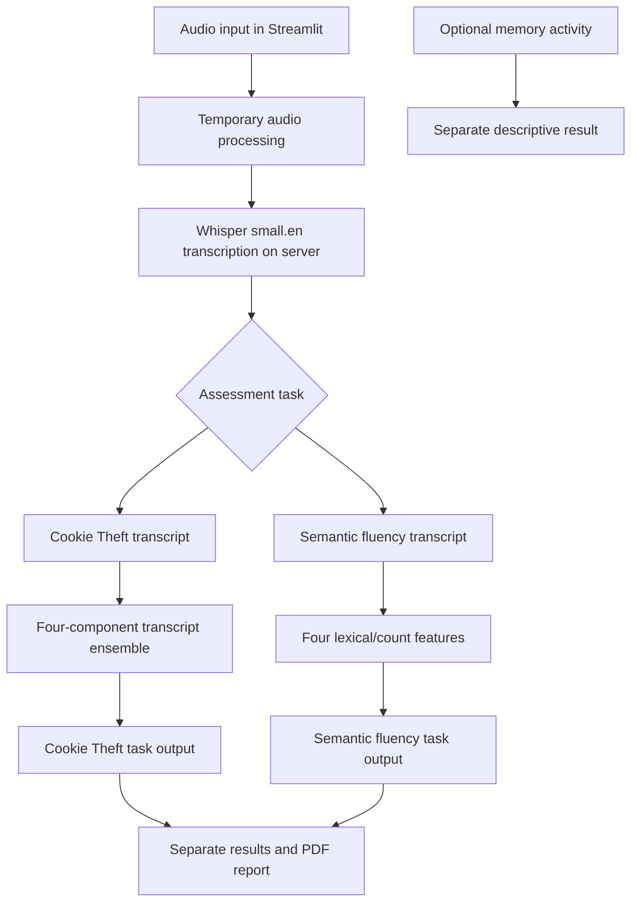

# NeuroVoice Architecture Notes

## Scope

This document describes the current checked-in Streamlit application path. It distinguishes deployed inference from separate experimental evaluation artifacts in the repository.

## Runtime flow

## Audio and transcription

The application accepts recordings through its Streamlit interface. The configured English Whisper model transcribes audio on the application server. Temporary audio files are removed by the transcription function after processing. The audio-input widget may retain the recording for the active Streamlit session.

## Cookie Theft inference

The checked-in implementation in `src/cookie_model.py` loads four transcript-based components:

1. Word TF-IDF + linear SVM.
2. Character TF-IDF + linear SVM.
3. Linguistic-feature logistic regression.
4. Combined word/character/linguistic logistic regression.

The current ensemble weights are loaded from `models/cookie/validation_selected_configuration.csv`: 0.45, 0.15, 0.05, and 0.35. The saved decision threshold is 0.61.

Important distinction: the current Streamlit inference path does not load an acoustic classifier. The separate transcript–acoustic fusion evaluation described under `assets/data/picture/` is a research artifact and must not be represented as the deployed application model.

## Semantic Verbal Fluency inference

The application derives four features from the transcript:

- Total alphabetic tokens.
- Unique tokens.
- Repeated tokens.
- Type-token ratio (unique tokens divided by total tokens).

The saved classifier uses a threshold of 0.52. The current feature extraction does not independently verify that words are valid animal names, so lexical counts should not be described as validated animal-retrieval scores.

## Optional memory activity and reporting

The optional memory activity is separate and descriptive. It is not combined with the speech-model outputs into a single diagnostic or screening score. The application can present task-specific results and generate a downloadable PDF report.

## Research artifacts versus deployed code

The repository contains evaluation figures and reports from broader experiments. These are not automatically the same as the models loaded by the deployed application.

- Cookie Theft fusion report: a separate transcript–acoustic stacking experiment, with post-hoc filtering of the reviewed test subset and a reconstructed fusion pipeline. Not the deployed transcript-only ensemble.
- Semantic fluency experiment: nested cross-validation on Pitt AD participants and WLS controls. Diagnosis group is confounded with dataset source, limiting interpretation and generalization.

Consult [MODEL_CARD.md](MODEL_CARD.md) for evaluation caveats, intended use, risks, and limitations.

## Key implementation files

- `app.py`: Streamlit application entry point and page registration.
- `src/`: transcription, feature extraction, and inference logic.
- `views/`: Streamlit pages and user-facing workflow.
- `models/`: serialized model artifacts and configuration.
- `notebooks/`: model-development and research notebooks.
- `assets/charts/`: research evaluation figures.
- `assets/data/`: permitted derived evaluation artifacts.

## Engineering priorities

1. Keep model training, evaluation, and inference preprocessing identical and versioned.
2. Record model artifact provenance, feature schemas, thresholds, and dependency versions.
3. Enforce participant-level separation in every experiment with repeated recordings.
4. Add tests that verify inference loads the intended artifacts and produces task-specific outputs.
5. Avoid storing unnecessary copies of uploaded audio or sensitive participant information.
6. Keep the optional memory activity separate from speech-model interpretation.
