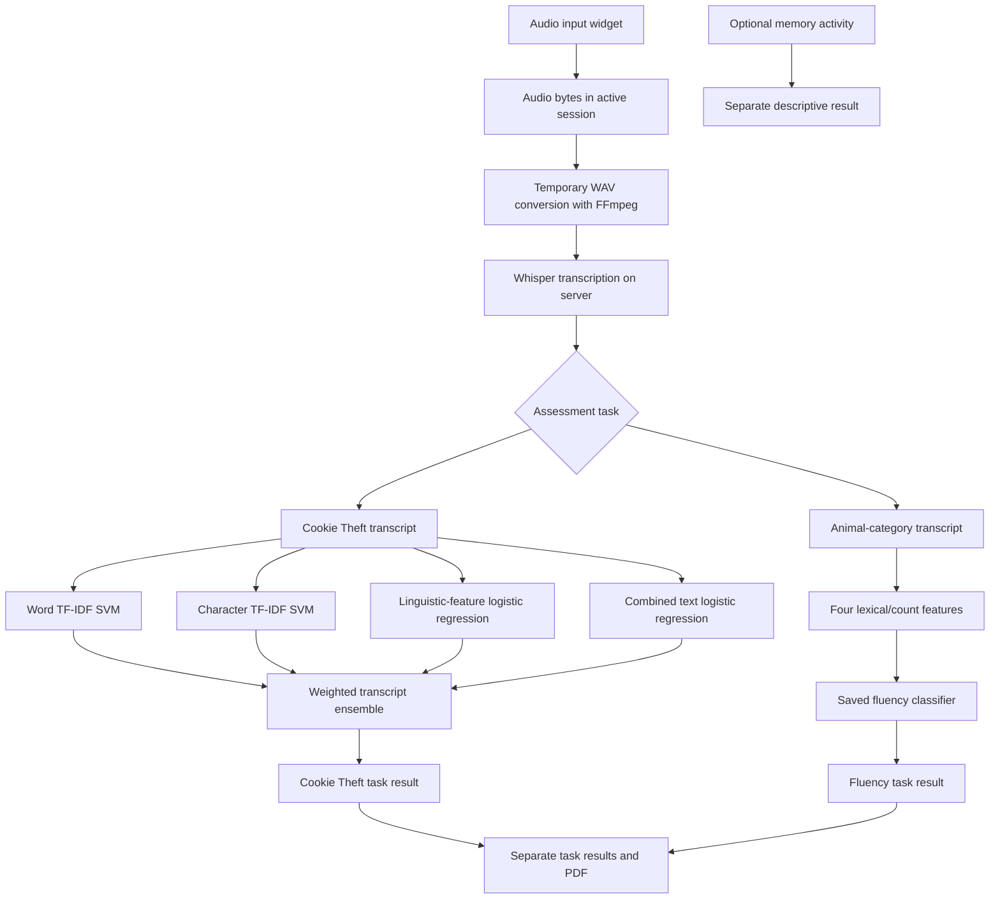

# NeuroVoice architecture

## Deployed Streamlit application

## Important implementation distinction

The deployed Cookie Theft inference code in `src/cookie_model.py` loads four transcript models. It does not load an acoustic model. The transcript–acoustic stacking metrics under `assets/data/picture/` describe a separate experiment and must not be presented as metrics for the current web-app inference path.

The optional memory activity is a separate exercise. It must not be combined with the two speech-model outputs into a weighted disease or screening score.

## Data flow and retention

- The audio-input widget supplies audio to the Streamlit server.
- `src/transcription.py` writes temporary source/normalized audio files inside a temporary directory.
- FFmpeg converts audio to mono 16-kHz WAV with filtering.
- Whisper runs as a local model process on the server.
- The temporary directory is removed when transcription returns or raises an error.
- The app should not create a second persistent copy of uploaded audio in session state.
- Streamlit's audio-input widget can retain the uploaded file during the active session; session reset or expiration should clear it.
